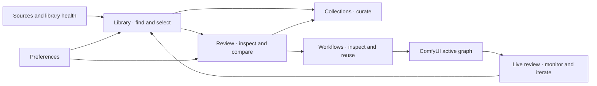

# Experience architecture for a media-first Majoor

This is a **design proposal**, not a map of existing URL routes. Kimi may improve the structure if it preserves capability coverage and makes the primary tasks easier. Read the capability map before choosing a layout.

## Product intent

A local creative workspace for finding generated media, understanding its provenance, comparing variations, organizing keepers and returning useful assets/workflows to ComfyUI. The media should dominate. Filenames, metadata, execution controls and maintenance are useful when they explain or advance the user's current task.

Primary user: a frequent ComfyUI creator with large local libraries, external storage, repeated generations and reusable graphs. Secondary mode: the same user debugging provenance, file indexing or host integration. Do not invent team administration, cloud sharing, stock-asset commerce or collaboration requirements.

The user explicitly selected **media-first workspace**: quiet chrome, strong typography, large previews and advanced controls revealed when needed. No supplied brand system constrains the solution. Kimi should choose and document a restrained visual language, with a neutral image-surround, a deliberate accent and legible information density. Evaluate visual hierarchy through the tasks below rather than copying Majoor's current toolbars.

## Product objects and distinctions

| Object | Identity / relationships | Design implication |
| --- | --- | --- |
| Asset | Indexed ID when available; file path/root/type, media kind, file facts and metadata | Missing ID or file is possible. Do not use thumbnail URL as identity. |
| Source/root | Output, input or registered external directory; availability and active watcher scope | Root removal is not file deletion. Missing removable drive is not an empty library. |
| Collection | Named logical membership, potentially spanning source files | Remove membership and delete source file require distinct actions. |
| Stack | Job/node-related group of output assets; cover and member list | Separate generation relationships from exact duplicates and similarity results. |
| Workflow | JSON document, category/path, descriptive metadata, validation, versions, usage | Saved workflow, asset-embedded workflow and active host graph are three distinct contexts. |
| Review session | Active asset, selected set, compare slots, pinned references, display adjustments | Ephemeral review state should not masquerade as file edits. |
| Operation | Scan, enrichment, export, write, validation or host execution | Show progress and failure at the right scope; only offer cancellation if contract supports it. |
| Preference / capability | Browser settings, persisted server settings, host support, optional dependency health | Enabled, configured, available and loaded are different states. |

## Proposed information architecture

The primary shell needs only a few destinations. Review is normally a contextual workspace reached from media; Sources/Health and Preferences are secondary destinations. These can be tabs, panels or full-width modes. They do not require a seven-item permanent sidebar.

| ID / surface | User intent | Main hierarchy | Primary actions | Secondary / advanced | Required states |
| --- | --- | --- | --- | --- | --- |
| **P1 Library** | Find the right media and select what to work on | Source/context, search, media results; contextual inspector or selection tray | Search, filter, open, rate, select, compare, add to collection | Folder operations, staging, export, similarity, duplicate alert | Loading, initial empty, filtered empty, missing root, unindexed file, selected many, stack expansion, read-only, partial metadata |
| **P2 Review** | Understand a result and choose among variants | Large preview; compact navigation/filmstrip; optional metadata drawer | Next/previous, rate/tag, pin, compare, Open workflow | Analysis tools, copy provenance, graph inspection, frame capture, clean export | Image/video/audio/3D, decode failure, no workflow, API-only workflow, loading metadata, compare slots empty, popup blocked |
| **P3 Collections** | Gather useful outputs into a coherent set | Collection navigator/detail and media results using the shared library primitives | Create, add/remove membership, open, rename only if supported by implementation chosen | AI ideas and group discovery, collection deletion | No collections, empty collection, partial add/duplicates skipped, source unavailable, AI unavailable |
| **P4 Live review** | Follow an active generation and compare its results | Preview first; source/follow mode and execution state; pinned reference strip | Follow outputs, select node stream, preview sampling, pin result | Node parameters, explicit Run/Stop, Graph Map, popout | Idle, queued/running, preview-only, completed, failed/interrupted, unsupported node, disconnected host |
| **P5 Workflows** | Find, inspect and safely reuse a graph | Workflow cards; task/model/category; selected workflow inspector | Load, inspect, save current, import, favorite | Edit info, thumbnail, duplicate/category, validation/revision diff | No documents, invalid JSON, unknown models, missing nodes, dirty canvas, unavailable host importer, overwrite conflict |
| **P6 Sources & library health** | Make files available and understand missing/stale results | Source list, current watch scope, scan/index status and operation results | Add root, browse path, scan, enable watching, inspect failure | Duplicate review, AI backfill/coverage, backup/restore, maintenance; proposed audit tab | Disconnected drive, denied path, scanning, partial scan, degraded tools, insufficient vector coverage, write blocked, restore confirmation |
| **P7 Preferences** | Set behavior without interrupting review | Searchable sections: Appearance, Viewer, Sources, AI, Performance, Access, Advanced/help | Adjust preferences, see effect/scope, restore individual defaults where implemented | Token setup, probes, DB tuning, logging, experimental format toggles | Saved/unsaved as appropriate, apply failed, invalid path, restart needed if applicable, capability unavailable |

Feature-to-surface mapping is exhaustive in `capability-map.json`. Backend-only features belong in implementation planning; Kimi should not silently promote them to fully functional prototype promises.

## Primary journeys to design

### J1 — Find, compare, keep and reopen

Start at mixed-media Outputs. Search a synthetic prompt term, filter to images, select two variations, compare A/B, rate one, add it to a collection, then choose **Open workflow**. Retain search, scroll and selection context on return. Opening the workflow creates a new host tab and does not execute it. Show a different message when only execution metadata is embedded and original canvas layout is unavailable.

### J2 — See files copied to an external generation folder

Open Sources, add a concrete external `characters/sample-character/GENERATIONS` directory, run a recursive scan, then browse it in Library. Show current watch target clearly. A second registered root must not misleadingly show simultaneous active watching: the current backend supports output OR one custom root. A future multi-root design may be shown only as an explicitly labeled proposal. Include unplugged drive, empty directory and no matching results as three different states. Do not inspect the user's real folders for fixtures.

### J3 — Iterate while a generation runs

Open Live review; identify completed-output stream, selected-node stream and sampler preview separately. Pin a prior result. Simulate a running preview, completion and new saved result. Show parameter editing only in an explicit active-graph context. Run queues; Stop interrupts; ordinary viewer navigation does neither. Return the completed result to Library.

### J4 — Reuse a stored workflow safely

Filter workflow cards by task/model, inspect graph and validation, then load it. Demonstrate dirty-canvas protection. Show the difference between missing metadata and missing dependencies. Edit notes/category, choose an output thumbnail and inspect a revision comparison. Do not imply automatic model installation, a Git repository or a universal undo history.

### J5 — Export for a different purpose

From an asset or selection, clearly distinguish original download, clean copy, selection ZIP, and Collect Files. A Collect Files result should identify asset/workflow/input inclusion, omitted missing inputs, model references without weights, and actual archive destination. Demonstrate partial success; do not make every archive look complete.

### J6 — Recover from a library problem

Start with an unavailable source or stale asset. Explain whether the issue concerns filesystem availability, metadata index, vector enrichment or browser preview. Offer the relevant retry/scan; keep normal browsing usable when AI is disabled. Move destructive database controls out of the browsing flow. In duplicate review, merge tags and delete redundant files remain separate decisions.

## Shared interaction principles

- One strong contextual action and a small set of frequent actions; group rarer actions by outcome, with discoverable text labels. Keyboard shortcuts accelerate visible actions.
- Represent file kind and capability before choosing controls. A video has playback, an audio file has audio controls, a model has orbit/animation, and a workflow has inspect/load.
- Selection changes the action scope visibly: “2 selected” versus a single active inspector asset. Never silently apply an action to offscreen search results.
- Preserve orientation through breadcrumb/source, result count, active filters and back-to-results behavior. Avoid destructive clearing when opening review.
- Show progress where the action began and in a small persistent activity summary. Do not turn routine indexing into a full-screen blocker.
- Comparison keeps media dominant. Analysis tools, raw JSON and graph parameters expand only when requested.
- Root, path, collection, stack and workflow categories use distinct language. Avoid generic “Remove” without saying what is removed.
- Display changes need a reset action and a clear “view only” indication; do not imply that exposure/gamma are saved edits.
- Honor ComfyUI's host controls and keyboard ownership. Inputs, dialogs and focused players should not leak shortcuts into the canvas.

## Layout behavior to explore

These sizes are evaluation scenarios, not existing product breakpoints. Kimi defines the exact tokens and responsive rules.

- **Wide workspace, about 1440 × 900:** media grid or viewer owns most area; navigation compact; inspector optional; bottom feed compatible with the canvas.
- **Compact workspace, about 1024 × 768:** reduce secondary columns, use drawers, retain direct search and main action.
- **ComfyUI side panel, about 360–480 px wide:** shallow source/search controls, smaller grid, details replace or overlay rather than squeezing two unusable columns.
- **Detached review, about 900 × 650:** media/player first; controls wrap intentionally; graph/info tools become drawers.

Desktop production work is the priority. Specify compact behavior without inventing a separate mobile product. The fork remains a ComfyUI extension; full-width designs must explain how they are entered, exited and resized within the host.

## Accessibility requirements for the design

Visible focus, keyboard-reachable actions, semantic controls, meaningful icon labels, sufficient text/control contrast, non-color status indicators, reduced-motion behavior, announced async results, focus return after dialogs, escape behavior and usable truncated filenames. Test long filenames, long translations, large font scaling and nested scroll containers. Specify focus ownership for library arrows, media frame stepping, text editing and host graph shortcuts.
